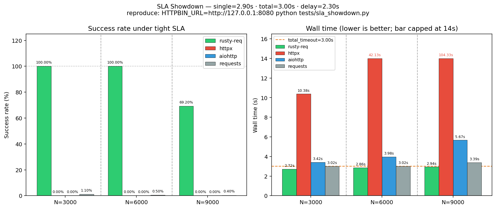

# rusty-req

[](https://pypi.org/project/rusty-req/)
[](https://pypi.org/project/rusty-req/)
[](https://opensource.org/licenses/MIT)
[](https://www.python.org/downloads/)
[](https://github.com/KAY53N/rusty-req/issues)
[](https://github.com/KAY53N/rusty-req/actions/workflows/build.yml)
[](https://github.com/KAY53N/rusty-req/actions/workflows/cross-platform-test.yml)

A high-performance asynchronous request library based on Rust and Python, suitable for scenarios that require high-throughput concurrent HTTP requests. It implements the core concurrent logic in Rust and packages it into a Python module using [PyO3](https://pyo3.rs/) and [maturin](https://github.com/PyO3/maturin), combining Rust's performance with Python's ease of use.

---

### 🌐 [English](README.md) | [中文](README.zh.md)

## 🚀 Features

-   **Dual Request Modes**: Supports both batch concurrent requests (`fetch_requests`) and single asynchronous requests (`fetch_single`).
-   **High Performance**: Built with Rust, Tokio, and a shared `reqwest` client for maximum throughput.
-   **Highly Customizable**: Allows custom headers, parameters/body, per-request timeouts, and tags.
-   **Flexible Concurrency Modes**: Choose between `SELECT_ALL` (default, get results as they complete) and `JOIN_ALL` (wait for all requests to finish) to fit your use case.
-   **Smart Response Handling**: Automatically decompresses `gzip`, `brotli`, and `deflate` encoded responses.
-   **Global Timeout Control**: Use `total_timeout` in batch requests to prevent hangs.
-   **Detailed Results**: Each response includes the HTTP status, body, metadata (like processing time), and any exceptions.
-   **Debug Mode**: An optional debug mode (`set_debug(True)`) prints detailed request/response information.

## 🔧 Installation

```bash
pip install rusty-req
```
Or build from source:
```
# This will compile the Rust code and create a .whl file
maturin build --release

# Install from the generated wheel
pip install target/wheels/rusty_req-*.whl
```

## Development & Debugging
```
cargo watch -s "maturin develop"
```

## ⚙️ Proxy Configuration & Debug

### 1. Using Proxy

If you need to access external networks through a proxy, create a `ProxyConfig` object and set it as a global proxy:

```python
import asyncio
import rusty_req

async def proxy_example():
    # Create ProxyConfig object
    proxy = rusty_req.ProxyConfig(
        http="http://127.0.0.1:7890",
        https="http://127.0.0.1:7890"
    )

    # Set global proxy (all requests will use this proxy)
    await rusty_req.set_global_proxy(proxy)

    # Send request (will go through proxy automatically)
    resp = await rusty_req.fetch_single(url="https://httpbin.org/get")
    print(resp)

if __name__ == "__main__":
    asyncio.run(proxy_example())
```

### 2. Debug Logging

`set_debug` enables debug mode, supporting **console output** and **log file writing**:

```python
import rusty_req

# Print debug logs to console only
rusty_req.set_debug(True)

# Print to console and write to log file
rusty_req.set_debug(True, "logs/debug.log")

# Disable debug mode
rusty_req.set_debug(False)
```

## 📦 Example Usage
### 1. Fetching a Single Request (`fetch_single`)
Perfect for making a single asynchronous call and awaiting its result.

```python
import asyncio
import pprint
import rusty_req

async def single_request_example():
    """Demonstrates how to use fetch_single for a POST request."""
    print("🚀 Fetching a single POST request to httpbin.org...")

    # Enable debug mode to see detailed logs in the console
    rusty_req.set_debug(True)

    response = await rusty_req.fetch_single(
        url="https://httpbin.org/post",
        method="POST",
        params={"user_id": 123, "source": "example"},
        headers={"X-Client-Version": "1.0"},
        tag="my-single-post"
    )

    print("\n✅ Request finished. Response:")
    pprint.pprint(response)

if __name__ == "__main__":
    asyncio.run(single_request_example())
```

### 2. Fetching Batch Requests (`fetch_requests`)

The core feature for handling a large number of requests concurrently. This example simulates a simple load test.
```python
import asyncio
import time
import rusty_req
from rusty_req import ConcurrencyMode

async def batch_requests_example():
    """Demonstrates 100 concurrent requests with a global timeout."""
    requests = [
        rusty_req.RequestItem(
            url="https://httpbin.org/delay/2",  # This endpoint waits 2 seconds
            method="GET",
            timeout=2.9,  # Per-request timeout, should succeed
            tag=f"test-req-{i}",
        )
        for i in range(100)
    ]

    # Disable debug logs for cleaner output
    rusty_req.set_debug(False)

    print("🚀 Starting 100 concurrent requests...")
    start_time = time.perf_counter()

    # Set a global timeout of 3.0 seconds. Some requests will be cut off.
    responses = await rusty_req.fetch_requests(
        requests,
        total_timeout=3.0,
        mode=ConcurrencyMode.SELECT_ALL # Explicitly use SELECT_ALL mode
    )

    total_time = time.perf_counter() - start_time

    # --- Process results ---
    success_count = 0
    failed_count = 0
    for r in responses:
        # Check the 'exception' field to see if the request was successful
        if r.get("exception") and r["exception"].get("type"):
            failed_count += 1
        else:
            success_count += 1

    print("\n📊 Load Test Summary:")
    print(f"⏱️  Total time taken: {total_time:.2f}s")
    print(f"✅ Successful requests: {success_count}")
    print(f"⚠️ Failed or timed-out requests: {failed_count}")

if __name__ == "__main__":
    asyncio.run(batch_requests_example())
```

### 3. Understanding Concurrency Modes (`SELECT_ALL` vs `JOIN_ALL`)

The `fetch_requests` function supports two powerful concurrency strategies. Choosing the right one is key to building robust applications.

-   **`ConcurrencyMode.SELECT_ALL` (Default): Best-Effort Collector**
    This mode operates on a "first come, first served" or "best-effort" basis. It aims to collect as many successful results as possible within the given `total_timeout`.
    -   It returns results as soon as they complete.
    -   If the `total_timeout` is reached, it gracefully returns all the requests that have already succeeded, while marking any still-pending requests as timed out.
    -   **A failure in one request does not affect others.**

-   **`ConcurrencyMode.JOIN_ALL`: Transactional (All-or-Nothing)**
    This mode treats the entire batch of requests as a single, atomic transaction. It is much stricter.
    -   It waits for **all** submitted requests to complete first.
    -   It then inspects the results.
    -   **Success Case**: Only if *every single request was successful* will it return the complete list of successful results.
    -   **Failure Case**: If *even one request fails* for any reason (e.g., its individual timeout, a network error, or a non-2xx status code), this mode will discard all results and return a list where **every request is marked as a global failure.**

### 4. Timeout Performance Comparison (SLA showdown)

Same hard SLA for every library:

| Parameter | Value |
|-----------|--------|
| Server delay | **2.3s** (`/delay/2.3`) |
| Per-request timeout | **2.9s** |
| Batch / global budget | **3.0s** |
| Concurrency ladder | **N = 3000 → 6000 → 9000** (full burst each level) |

Measured on **0.4.26** (local go-httpbin). Anyone can reproduce after clone:

#### How we run the benchmark

```bash
# 0) clone & enter the repo
git clone https://github.com/KAY53N/rusty-req.git
cd rusty-req

# 1) Python deps for the four clients under test
pip install maturin aiohttp httpx requests

# 2) build / install this repo's rusty-req (recommended: from source)
#    needs a working Rust toolchain (rustup)
maturin develop --release
# alternative: pip install rusty-req   # PyPI wheel; version may lag main

# 3) start a local delay server (go-httpbin; multi-arch, good under load)
#    avoid kennethreitz/httpbin on Apple Silicon — often 502 under concurrency
docker run -d --name httpbin -p 8080:8080 mccutchen/go-httpbin:latest
# wait until healthy
curl -sf http://127.0.0.1:8080/status/200

# 4) clear proxy env so local traffic is not hijacked
unset http_proxy https_proxy HTTP_PROXY HTTPS_PROXY ALL_PROXY all_proxy

# 5) run the SLA showdown (default stages: 3000, 6000, 9000)
HTTPBIN_URL=http://127.0.0.1:8080 python tests/sla_showdown.py

# optional variants:
#   python tests/sla_showdown.py --stages 3000,6000           # shorter run
#   python tests/sla_showdown.py                             # no Docker: embedded /delay server
#   python tests/sla_showdown.py --single-timeout 2.9 --total-timeout 3.0 --delay 2.3
```

What the script does:

1. For each concurrency level **N**, fires **N** concurrent GETs to `/delay/2.3`.
2. Compares **rusty-req**, **httpx**, **aiohttp**, **requests** under the same timeouts.
3. Prints **success rate**, **wall time**, whether the batch stayed within the 3s SLA, **http_status** mix, and (for rusty-req) **exception.type** mix.
4. Writes `tests/sla_showdown_result.json` (gitignored) for local inspection.

Notes:

- **requests** uses at most **32 OS threads** on purpose (safe on macOS). That is not N-way concurrency.
- Do not point the bench at a corporate HTTP proxy for `127.0.0.1`.
- Numbers vary slightly by machine / Docker; the relative ranking is what matters.

| Library | N=3000 success / time | N=6000 success / time | N=9000 success / time | Notes |
|---------|----------------------|----------------------|----------------------|-------|
| **rusty-req** | **100.00%** / 2.72s | **100.00%** / 2.86s | **69.20%** / 2.94s | Native dual timeouts; full success at 3k/6k inside the 3s SLA |
| **httpx** | **0.00%** / 10.38s | **0.00%** / 42.13s | **0.00%** / 104.33s | Misses the global budget; wall time overshoots badly on cancel |
| **aiohttp** | **0.00%** / 3.42s | **0.00%** / 3.98s | **0.00%** / 5.67s | Fails the same tight SLA from 3k upward |
| **requests** | **1.10%** / 3.02s | **0.50%** / 3.02s | **0.40%** / 3.39s | Only ~32 successes each run (32-thread pool); not N-way concurrent |

`rusty-req` detail:

- N=3000 / 6000: **http_status 200 = 100%**, **exception empty = 100%**
- N=9000: **http_status 200 = 69.20%**, **0 = 30.80%**; exception **None 69.20%** / **HttpError 30.80%** (still finishes inside ~2.94s)

Key takeaways:
- **rusty-req** holds **100%** success at **3000** and **6000** concurrent requests within the global timeout; at **9000** it still completes the batch in **2.94s** with ~69% success under machine/Docker pressure.
- **aiohttp** and **httpx** are **0%** across these high-concurrency SLA levels; httpx wall time grows to **10s / 42s / 104s**.
- **requests** stays around **~32 OK** regardless of N (thread cap); the falling % is mostly a larger denominator, not better throughput.



---

### Quick Comparison

| Aspect                | `ConcurrencyMode.SELECT_ALL` (Default)                               | `ConcurrencyMode.JOIN_ALL`                                          |
| :-------------------- | :------------------------------------------------------------------- | :------------------------------------------------------------------ |
| **Failure Handling**  | **Tolerant**. One failure does not affect other successful requests. | **Strict / Atomic**. One failure causes the entire batch to fail. |
| **Primary Use Case**  | Maximizing throughput; getting as much data as possible.             | Tasks that must succeed or fail as a single unit (e.g., transactions). |
| **Result Order**      | By completion time (fastest first).                                  | By original submission order.                                       |
| **"When do I get results?"** | As they complete, one by one.                                        | All at once, only after every request has finished and been validated. |

---

### Code Example

The example below clearly demonstrates the difference in behavior.

```python
import asyncio
import rusty_req
from rusty_req import ConcurrencyMode

async def concurrency_modes_example():
    """Demonstrates the difference between SELECT_ALL and JOIN_ALL modes."""
    # Note: We are using an endpoint that returns 500 to force a failure.
    requests = [
        rusty_req.RequestItem(url="https://httpbin.org/delay/2", tag="should_succeed"),
        rusty_req.RequestItem(url="https://httpbin.org/status/500", tag="will_fail"),
        rusty_req.RequestItem(url="https://httpbin.org/delay/1", tag="should_also_succeed"),
    ]

    # --- 1. Test SELECT_ALL ---
    print("--- 🚀 Testing SELECT_ALL (Best-Effort) ---")
    results_select = await rusty_req.fetch_requests(
        requests,
        mode=ConcurrencyMode.SELECT_ALL,
        total_timeout=3.0
    )

    print("Results:")
    for res in results_select:
        tag = res.get("meta", {}).get("tag")
        status = res.get("http_status")
        err_type = res.get("exception", {}).get("type")
        print(f"  - Tag: {tag}, Status: {status}, Exception: {err_type}")

    print("\n" + "="*50 + "\n")

    # --- 2. Test JOIN_ALL ---
    print("--- 🚀 Testing JOIN_ALL (All-or-Nothing) ---")
    results_join = await rusty_req.fetch_requests(
        requests,
        mode=ConcurrencyMode.JOIN_ALL,
        total_timeout=3.0
    )

    print("Results:")
    for res in results_join:
        tag = res.get("meta", {}).get("tag")
        status = res.get("http_status")
        err_type = res.get("exception", {}).get("type")
        print(f"  - Tag: {tag}, Status: {status}, Exception: {err_type}")

if __name__ == "__main__":
    asyncio.run(concurrency_modes_example())
```
The expected output from the script above:

```
--- 🚀 Testing SELECT_ALL (Best-Effort) ---
Results:
  - Tag: should_also_succeed, Status: 200, Exception: None
  - Tag: will_fail, Status: 500, Exception: HttpStatusError
  - Tag: should_succeed, Status: 200, Exception: None

==================================================

--- 🚀 Testing JOIN_ALL (All-or-Nothing) ---
Results:
  - Tag: should_succeed, Status: 0, Exception: GlobalTimeout
  - Tag: will_fail, Status: 0, Exception: GlobalTimeout
  - Tag: should_also_succeed, Status: 0, Exception: GlobalTimeout
```

## 🧱 Data Structures

### `RequestItem` Parameters

| Field             | Type            | Required | Description                                                                                                                                    |
|:------------------|:----------------|:--------:|:-----------------------------------------------------------------------------------------------------------------------------------------------|
| `url`             | `str`           |    ✅     | The target URL.                                                                                                                                |
| `method`          | `str`           |    ✅     | The HTTP method.                                                                                                                               |
| `params`          | `dict` / `None` |    No    | For GET/DELETE, converted to URL query parameters. For POST/PUT/PATCH, sent as a JSON body.                                                    |
| `headers`         | `dict` / `None` |    No    | Custom HTTP headers.                                                                                                                           |
| `tag`             | `str`           |    No    | An arbitrary tag to help identify or index the response.                                                                                       |
| `http_version`    | `str`           |    No    | The default behavior when the HTTP version is set to “Auto” is to attempt HTTP/2 first, and fall back to HTTP/1.1 if HTTP/2 is not supported.  |
| `ssl_verify`      | `bool`          |    No    | **SSL certificate verification** (default `True`, set `False` to disable for self-signed certificates)      |
| `timeout`         | `float`         |    ✅     | Timeout for this individual request in seconds. Defaults to 30s.                                                                               |

---

### `ProxyConfig` Parameters

| Field       | Type                 | Required | Description                                                                 |
|:------------|:---------------------|:--------:|:----------------------------------------------------------------------------|
| `http`      | `str` / `None`       |    No    | Proxy URL for HTTP requests (e.g. `http://127.0.0.1:8080`).                  |
| `https`     | `str` / `None`       |    No    | Proxy URL for HTTPS requests.                                               |
| `all`       | `str` / `None`       |    No    | A single proxy URL applied to all schemes (overrides `http`/`https`).        |
| `no_proxy`  | `List[str]` / `None` |    No    | List of hostnames/IPs to exclude from proxying.                              |
| `username`  | `str` / `None`       |    No    | Optional proxy authentication username.                                      |
| `password`  | `str` / `None`       |    No    | Optional proxy authentication password.                                      |
| `trust_env` | `bool` / `None`      |    No    | Whether to respect system environment variables (`HTTP_PROXY`, `NO_PROXY`).  |

---

### `fetch_requests` Parameters

| Field           | Type                  | Required | Description                                                                                             |
| :-------------- | :-------------------- | :------: | :------------------------------------------------------------------------------------------------------ |
| `requests`      | `List[RequestItem]`   |    ✅    | A list of `RequestItem` objects to be executed concurrently.                                            |
| `total_timeout` | `float`               |    No    | A global timeout in seconds for the entire batch operation.                                             |
| `mode`          | `ConcurrencyMode`     |    No    | The concurrency strategy. `SELECT_ALL` (default) for best-effort collection. `JOIN_ALL` for atomic (all-or-nothing) execution. See Section 3 for a detailed comparison.|

---

### `fetch_single` Parameters

| Field         | Type                  | Required | Description                                                                                                     |
|:--------------|:--------------------|:--------:|:----------------------------------------------------------------------------------------------------------------|
| `url`         | `str`               | ✅       | The target request URL.                                                                                          |
| `method`      | `str` / `None`      | No       | HTTP method, e.g., `"GET"`, `"POST"`. If not provided, the client may handle defaults.                          |
| `params`      | `dict` / `None`     | No       | Request parameters. For GET/DELETE, converted to URL query parameters; for POST/PUT/PATCH, sent as JSON body.   |
| `timeout`     | `float` / `None`    | No       | Timeout for this request in seconds. Defaults to 30s.                                                           |
| `headers`     | `dict` / `None`     | No       | Custom HTTP request headers.                                                                                    |
| `tag`         | `str` / `None`      | No       | Arbitrary tag to help identify or index the response.                                                           |
| `proxy`       | `ProxyConfig` / `None` | No    | Optional proxy configuration. Applied to this request if provided.                                              |
| `http_version`| `HttpVersion` / `None` | No    | HTTP version choice, usually supports `"Auto"` (try HTTP/2, fallback to HTTP/1.1), `"1.1"`, `"2"`, etc.         |
| `ssl_verify`  | `bool` / `None`     | No       | Whether to verify SSL certificates. Defaults to `True`; set `False` to ignore self-signed certificates.        |

---

### Response Dictionary Format

Both `fetch_single` and `fetch_requests` return a dictionary (or a list of dictionaries) with a consistent structure.

#### Example of a successful response:

```json
{
  "http_status": 200,
  "response": {
    "headers": {
      "access-control-allow-credentials": "true",
      "access-control-allow-origin": "*",
      "connection": "keep-alive",
      "content-length": "314",
      "content-type": "application/json",
      "date": "Wed, 10 Sep 2025 03:15:31 GMT",
      "server": "gunicorn/19.9.0"
    },
    "content": "{\"data\":\"...\", \"headers\":{\"...\"}}"
  },
  "meta": {
    "process_time": "2.0846",
    "request_time": "2025-09-10 11:22:46 -> 2025-09-10 11:22:48",
    "tag": "req-0"
  },
  "exception": {}
}
```

#### Example of a failed response (e.g., timeout):
```json
{
  "http_status": 0,
  "response": {
    "headers": {
      "access-control-allow-credentials": "true",
      "access-control-allow-origin": "*",
      "connection": "keep-alive",
      "content-length": "314",
      "content-type": "application/json",
      "date": "Wed, 10 Sep 2025 03:15:31 GMT",
      "server": "gunicorn/19.9.0"
    },
    "content": ""
  },
  "meta": {
    "process_time": "3.0012",
    "request_time": "2025-08-08 03:15:05 -> 2025-08-08 03:15:08",
    "tag": "test-req-50"
  },
  "exception": {
    "type": "Timeout",
    "message": "Request timeout after 3.00 seconds"
  }
}
```

## Changelog

For a detailed list of changes, see the [CHANGELOG](CHANGELOG.md)

---

## 📄 License
This project is licensed under the [MIT License](https://opensource.org/license/MIT).
